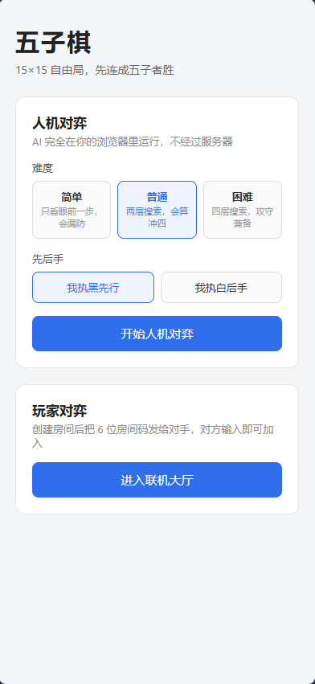
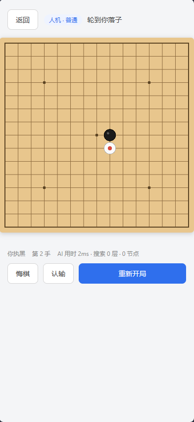
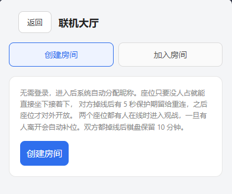
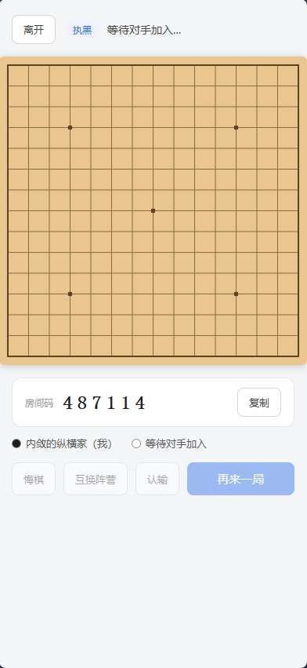
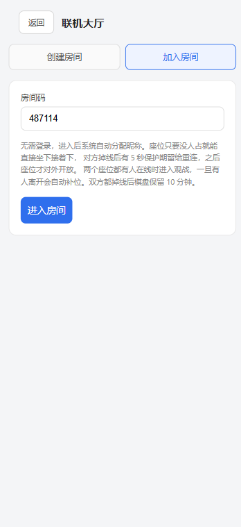
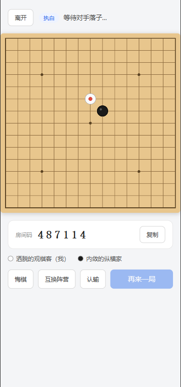
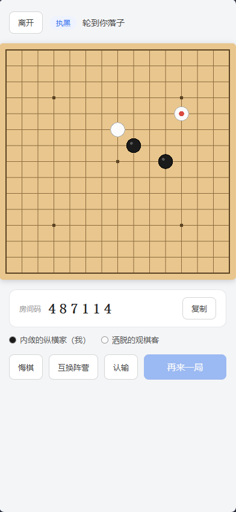

# 五子棋（Gomoku）

通过 WorkBuddy 生成的五子棋游戏

15×15 无禁手自由局，支持**人机对弈**与**联机玩家对弈**。后端无数据库，房间状态全部驻留内存。

## 技术栈

| 端 | 技术 |
|---|---|
| 前端 | Vue 3 + TypeScript + Vite 8，Canvas 绘制棋盘，AI 跑在 Web Worker |
| 后端 | Java 21 + Spring Boot 4.1.1，原生 WebSocket，无数据库 |

## 效果图
  
    


## 目录结构

```
gomoku/
├── gomoku-web/                 # 前端工程
│   └── src/
│       ├── game/               # 棋盘规则、AI 引擎、Worker
│       ├── net/                # HTTP 接口与 WebSocket 客户端
│       ├── components/         # 棋盘组件
│       └── views/              # 首页 / 人机 / 联机
├── gomoku-server/              # 后端工程
│   └── src/main/java/com/example/gomoku/
│       ├── controller/         # 建房、加入房间
│       ├── service/            # RoomManager：内存房间仓库 + 定时巡检
│       ├── ws/                 # WebSocket 握手、落子转发、会话绑定
│       └── model/              # Room / Player / 胜负判定
├── scripts/                    # 构建脚本
└── tools/                      # 联调与 AI 测试脚本
```

## 快速开始

### 开发模式（前后端分离，前端热更新）

```bash
# 终端 1：后端，监听 8080
cd gomoku-server
mvn spring-boot:run

# 终端 2：前端，监听 5173，已配置代理转发 /api 与 /ws 到后端
cd gomoku-web
npm install
npm run dev
```

浏览器打开 http://localhost:5173

### 生产模式（单 jar，前后端同源）

```bash
cd gomoku-web && npm install && npm run build
bash ../scripts/deploy-frontend.sh      # 把 dist 同步到后端 static
cd ../gomoku-server && mvn package -DskipTests
java -jar target/gomoku-server.jar
```

浏览器打开 http://localhost:8080

> **端口提示**：若启动后端口不是 8080，多半是环境里存在 `SERVER__PORT` 之类的变量
> （Spring Boot 的宽松绑定会把 `SERVER__PORT` 解析成 `server.port`，优先级高于配置文件）。
> 用 `--server.port=8080` 显式指定即可：
> `java -jar target/gomoku-server.jar --server.port=8080`

## 玩法

### 落子方式（两种模式一致）

采用**两段式落子**防手滑：第一次点击只在交叉点上做标记（半透明预览 + 红色高亮框），
第二次点击同一位置才真正落子；点到别的格子会把标记挪过去，按 `Esc` 取消。

### 人机对弈

AI 完全在浏览器里计算，不经过后端。三档难度：

| 难度 | 策略 | 单步耗时 |
|---|---|---|
| 简单 | 单点棋型评分 + 大随机扰动，会漏防 | < 100ms |
| 普通 | 迭代加深至多 4 层 + Alpha-Beta | < 100ms |
| 困难 | 迭代加深至多 8 层 + Alpha-Beta，无随机 | 通常 0.3~3s，上限 20s |

支持悔棋（回退到又轮到自己的局面）、认输、重新开局，可选执黑先行或执白后手。

### 玩家对弈

- **房间码**：6 位纯数字，生成时若冲突自动重试
- **昵称**：无需登录，进入时由服务端随机分配（如"沉稳的棋手"）
- **先后手**：房主固定执黑先行
- **悔棋**：需对方同意，不限次数。对方 30 秒未响应自动拒绝（前端约定，不阻塞对局）
- **再来一局**：需双方都点击
- **掉线**：棋盘原地保留等待重连，**不判负**
- **观战**：两个座位都有人在线时进入，自动成为观战者，只能看棋不能操作
- **互换阵营**：对局中可申请跟对手交换黑白，需对方同意（30 秒未响应自动拒绝）

### 座位分配与房间回收

进入房间时的身份判定，核心原则是「**有空位就直接坐下，没空位才观战**」：

| 顺序 | 条件 | 结果 |
|---|---|---|
| 1 | 请求带上次的 `token`，且属于该房间某个座位 | 坐回原座位，沿用原昵称与棋盘 |
| 2 | 有空位（座位没人，或座位上的人已离线且过了保护期） | 直接坐下，接着原来的局面下 |
| 3 | 两个座位都有人在线，或恰好卡在保护期内 | 观战者（seat -1） |

- 「空位」包含已掉线的座位：玩家中途退出后，下一个人进来就能接着下，不会干等着。
  棋盘、轮次、历史落子全部保留，昵称沿用原座位（对手视角里不会凭空换人）。
- **掉线保护期**（`seat-reserve-seconds`，默认 **5 秒**）：刚掉线的座位先为原主保留，
  防止网络抖动一断线就被路过的第三人抢走。**本人凭凭证回来不受此限**，可立即坐回原位。
- 前端把 `token` 存在 `sessionStorage`，刷新页面后会自动坐回原位，
  大厅页也会给出「回到我的座位」入口。WebSocket 断线后按 1s → 8s 退避自动重连。
- 观战者会周期性调用 `POST /api/rooms/{code}/seat` 尝试补位（约每 2.5 秒），
  保护期一过就自动入座，不需要手动刷新页面。
- **主动离开 ≠ 掉线**：点「离开」按钮会调用 `POST /api/rooms/{code}/leave`，
  座位**立即释放、不进入保护期**，别人可以马上进来接着下；而意外断网/关页面算掉线，
  才享受那 5 秒保护期。本地 `token` 仍保留，只要座位没被别人占，自己回来还能坐回原位。

回收策略（`application.yml`）：

| 情况 | 处理 |
|---|---|
| 还有玩家在线 | 一直保留，巡检不会打断进行中的对局 |
| 双方都掉线 | 棋盘保留 `abandoned-timeout-minutes`（默认 **10 分钟**）等人回来，超时才销毁 |
| 仍有观战者挂着 | 暂缓回收 |

```yaml
gomoku:
  room:
    abandoned-timeout-minutes: 10
    seat-reserve-seconds: 5
  sweep-interval-millis: 60000
```

## 测试

```bash
# 联调冒烟测试（需后端已启动）：建房 → 加入 → 对局 → 胜负 → 再来一局 → 认输 → 重连
node tools/smoke-test.mjs

# 房间回收测试：自行拉起临时实例（:8082，保留时长压到 0、巡检 1 秒）
# 验证双方掉线后会被回收、仍有一方在线时不会被回收
node tools/sweep-test.mjs

# AI 引擎测试：必胜必防判定、三档强度梯度、思考耗时
cd gomoku-web && npx esbuild ../tools/ai-test-entry.ts --bundle --format=esm \
  --platform=node --outfile=../tools/.tmp/ai-entry.mjs
node tools/ai-test.mjs
```

## 关键设计决策

**1. 落子必须经过服务端。** 前端只发送落子意图，服务端校验轮次、坐标合法性与重复落子，
并做权威胜负判定。前端计算出的人机对局结果不被信任。

**2. 胜负判定前后端各实现一份。** 人机模式在前端判定（无需网络往返），
联机模式在后端判定。两边规则完全一致：横、竖、两条斜线任意方向连五即胜，无禁手。

**3. 评估函数必须是严格零和的。** AI 的 negamax 要求 `eval(对手视角) === -eval(己方视角)`。
早期版本给对手棋型加了 0.95 的折扣权重，破坏了这一前提，导致「搜索越深棋力反而越弱」——
6 层搜索输给 3 层搜索。现在搜索档统一使用对称评估，难度差异只来自搜索深度与随机扰动。

**4. AI 放进 Web Worker。** 困难档单步搜索约 600~1700 个节点，放在主线程会让页面在落子瞬间卡死。

**5. 房间身份用一次性 token。** 无登录、无数据库，建房/加入时下发一个 UUID 作为凭证，
WebSocket 握手时携带，服务端据此绑定座位。座位号为 0/1 时对局者，-1 时是观战者。

**6. 迭代加深而不是固定深度。** 困难档从 2 层开始逐层 +2 加深，每层算完才替换结果；
某一层被时间打断就丢弃该层、沿用上一层，所以 20 秒预算被打断也总有一个完整答案。
另外「已算出必胜/必败」和「找到分值远超次优的走法」都会提前收手，不硬耗时间。

**7. 可能为 null 的响应字段一律显式输出。** `RoomState` 用 `@JsonInclude(ALWAYS)` 而非
`NON_NULL`：像 `undoRequestFrom`、`winnerSeat`、`lastMove` 为 null 时是有语义的
（没有待处理请求 / 和棋 / 还没落子），一旦被 Jackson 省略，前端拿到 `undefined`，
`=== null` 判断就会静默失效。

## 已知约束

- **只能单实例部署。** 房间状态存在 JVM 的 `ConcurrentHashMap` 里，多副本负载均衡会让
  同一房间的两名玩家落到不同实例上彼此不可见。如需多实例，需要引入 Redis 做房间存储与广播，
  那就与「不使用数据库」的前提冲突了。
- **服务重启会丢失所有房间。**
- **掉线不判负，靠空闲回收兜底**：掉线后棋盘原地保留。
  只有房间内既无在线玩家、也无观战者，且空闲超过 `abandoned-timeout-minutes`（默认 10 分钟），
  才会被巡检任务回收。掉线瞬间有 5 秒保护期，但保护期过后座位即对外开放——
  想给玩家更长的独占时间，调大 `seat-reserve-seconds` 即可。
- 观战者不限制人数，也没有发言权限（本项目未实现聊天）。

以上阈值均可在 `gomoku-server/src/main/resources/application.yml` 中调整：

```yaml
gomoku:
  room:
    # 双方都掉线后棋盘保留多久
    abandoned-timeout-minutes: 10
    # 掉线后座位的独占保护期（秒），这段时间内别人抢不走
    seat-reserve-seconds: 5
```
